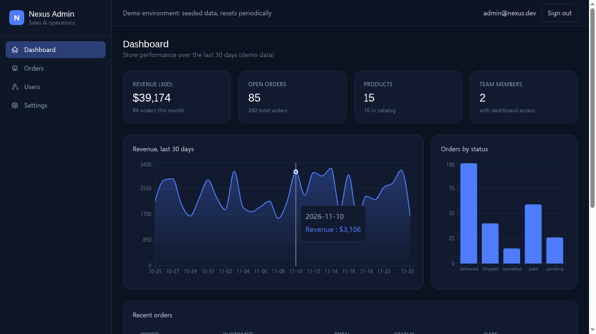

# Nexus Admin — Full-Stack Admin Dashboard + JWT Auth API

A production-style admin dashboard for a small e-commerce operation, built to demonstrate secure
authentication architecture, role-based access control, and a clean React front end.

**Live demo:** https://nexus-admin-two-alpha.vercel.app
**Demo accounts (seeded demo data only):** `admin@nexus.dev` or `viewer@nexus.dev` — password `NexusDemo!2026`

> The hosted demo runs on serverless functions with an in-memory data store, so data resets
> periodically. All customers, orders and metrics are fictional, deterministically seeded demo data.



## Stack

| Layer    | Tech |
| -------- | ---- |
| Frontend | React 18, Vite, Tailwind CSS, Recharts, React Router |
| Backend  | Node.js, Express 4 |
| Auth     | JWT access tokens (15 min) + rotating refresh tokens in httpOnly cookies, bcrypt password hashing |
| Security | Helmet, CORS whitelist, rate limiting, zod input validation |
| Data     | Zero-dependency JSON store: file persistence locally, in-memory on serverless |
| Tests    | node:test integration tests (auth flow, RBAC, validation, filtering) |

## Features

- Sign in with short-lived JWT access tokens; the client refreshes them silently in the background
- Refresh-token rotation with server-side revocation on logout and replay detection
- Role-based access control: `viewer` (read-only), `manager` (orders/products), `admin` (user management)
- Dashboard: 30-day revenue KPIs, revenue area chart, order-status breakdown, recent orders
- Orders: paginated, filterable by status, searchable by customer/ID, status updates (manager+)
- Users: create users, change roles, deactivate/reactivate accounts (admin only)
- Server-side validation with zod, consistent error shape (`error`, `message`, `fields`)
- Rate-limited auth endpoints against credential brute force

## API overview

| Method | Route | Access | Purpose |
| ------ | ----- | ------ | ------- |
| POST | `/api/auth/login` | public | Email + password → access token + refresh cookie |
| POST | `/api/auth/refresh` | refresh cookie | Rotate refresh token, issue new access token |
| POST | `/api/auth/logout` | refresh cookie | Revoke refresh token |
| GET | `/api/auth/me` | access token | Current user profile |
| GET | `/api/users` | manager, admin | List users |
| POST | `/api/users` | admin | Create user |
| PATCH | `/api/users/:id` | admin | Change role / activate / deactivate |
| GET | `/api/orders` | any role | Paginated orders (`status`, `q`, `page`, `pageSize`) |
| PATCH | `/api/orders/:id` | manager, admin | Update order status |
| GET | `/api/products` | any role | List products |
| POST | `/api/products` | manager, admin | Create product |
| GET | `/api/analytics/overview` | any role | KPIs, 90-day series, breakdowns |

## Run locally

```bash
npm install
npm run dev        # API on :5000, Vite dev server on :5173 (proxied)
npm test           # integration tests
```

Sign in with `admin@nexus.dev` / `NexusDemo!2026`.

Environment variables (optional locally, recommended in production):

| Variable | Default | Purpose |
| -------- | ------- | ------- |
| `JWT_SECRET` | dev fallback | **Set this in any real deployment** |
| `PORT` | `5000` | API port |
| `DATA_MODE` | `file` | `file` persists to `server/data/db.json`; `memory` reseeds per boot |
| `CLIENT_ORIGIN` | `http://localhost:5173` | CORS whitelist for local dev |

## Deployment

Deployed on Vercel as a single project: the React client builds to static assets, and
`api/index.js` wraps the Express app as a serverless function mounted at `/api/*`
(see `vercel.json`). On Vercel the store runs in `DATA_MODE=memory` (read-only filesystem),
so demo data resets on cold starts — this is intentional and labeled in the UI.

## What I would add next

- Refresh-token reuse detection with token families (the rotation plumbing is already in place)
- Audit log for admin actions
- Real database adapter (the store is deliberately isolated behind one module)

---

Built by [Omar Elsawaf](https://github.com/OmarELswaf) as a portfolio project.
